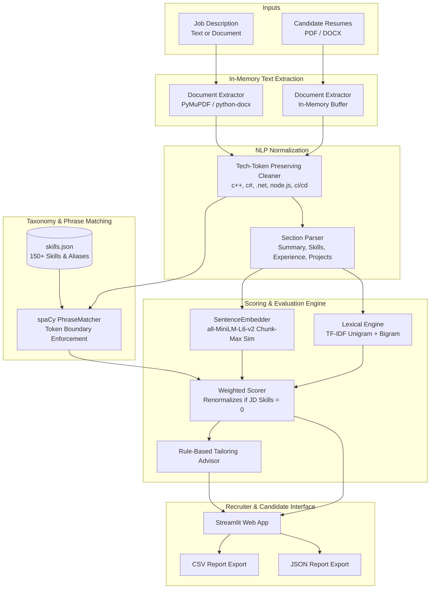

# 📄 Semantic Resume Ranker

A production-grade, explainable NLP tool that ranks candidate resumes against a job description (JD) using dense sentence embeddings, skill taxonomy extraction, section-aware relevance, and lexical TF-IDF scoring.

---

## 🌟 Key Features

- **Strictly In-Memory Processing**: Uploaded documents (`.pdf`, `.docx`) are parsed directly from memory streams. Files are never persisted to disk or sent to external 3rd-party APIs.
- **Robust Multi-Format Text Extraction**: Powered by PyMuPDF (`fitz`) and `python-docx` with edge-case protection against empty pages, corrupted buffers, and image-only PDFs lacking text layers.
- **Preserved Technical Terminology**: Dedicated preprocessing pipeline protecting symbols like `C++`, `C#`, `.NET`, `Node.js`, `Next.js`, and `CI/CD`.
- **Intelligent Section Detection**: Heuristic regex engine segmenting resumes into `Summary`, `Skills`, `Experience`, `Projects`, `Education`, and `Certifications`.
- **150+ Taxonomy-Backed Skill Matching**: Powered by spaCy `PhraseMatcher` with token-boundary enforcement (e.g., ensuring `Java` does not falsely match within `JavaScript`).
- **Semantic Sentence Embeddings**: Utilizes Hugging Face's `sentence-transformers` (`all-MiniLM-L6-v2`) with sliding-window chunking (200 words) for long-context semantic matching.
- **Multi-Factor Explainable Scoring**: Transparent formula combining semantic alignment, skill coverage, experience relevance, and lexical overlap.
- **Rule-Based Tailoring Suggestions**: Immediate, actionable feedback identifying missing skills, low-relevance experience sections, and missing quantifiable metrics.
- **Interactive Streamlit Web Dashboard**: Live weight customization sliders, detailed candidate inspection cards, colored skill badges, and one-click CSV/JSON export.

---

## 🏗️ Architecture



---

## 📐 Scoring Formula

The final candidate suitability score is computed on a **0 – 100** scale via four weighted components:

$$\text{Final Score} = w_{\text{semantic}} \cdot S_{\text{semantic}} + w_{\text{skill}} \cdot S_{\text{skill}} + w_{\text{exp}} \cdot S_{\text{exp}} + w_{\text{lexical}} \cdot S_{\text{lexical}}$$

### Default Weight Configuration
| Factor | Weight | Description |
| :--- | :---: | :--- |
| **`semantic_score`** | `0.35` | Max-chunk cosine similarity between candidate resume and JD via `all-MiniLM-L6-v2`. |
| **`skill_score`** | `0.40` | Percentage of requested JD skills satisfied: $\frac{|\text{Matched Skills}|}{|\text{JD Skills}|} \times 100$. |
| **`experience_section_score`** | `0.15` | Semantic alignment of the combined `Experience` + `Projects` sections against the JD. |
| **`lexical_score`** | `0.10` | TF-IDF cosine similarity (unigrams + bigrams, `sublinear_tf=True`). |

> [!NOTE]
> **Zero JD Skill Renormalization**: If a job description contains zero recognized skills, $S_{\text{skill}}$ is set to `None`, and the remaining weights ($0.35, 0.15, 0.10$) are automatically renormalized to sum to $1.0$. The candidate is **never penalized with a zero score** for unlisted skills.

---

## 🚀 Getting Started

### 1. Prerequisites
- Python 3.10, 3.11, or 3.12
- Git

### 2. Clone Repository & Setup Virtual Environment
```bash
git clone https://github.com/your-username/semantic-resume-ranker.git
cd semantic-resume-ranker

# Create and activate virtual environment
python -m venv .venv

# On Linux/macOS:
source .venv/bin/activate

# On Windows (PowerShell):
.venv\Scripts\Activate.ps1
```

### 3. Install Dependencies
```bash
pip install --upgrade pip
pip install -r requirements-dev.txt
python -m spacy download en_core_web_sm
```

### 4. Run the Streamlit Application
```bash
streamlit run app.py
```
Open your browser at `http://localhost:8501`.

---

## 🧪 Testing & Code Quality

The project includes unit tests covering edge cases, empty documents, corrupt buffers, token preservation, and score renormalization.

### Run Linter
```bash
flake8 .
```

### Run Pytest with Coverage Enforcement ($\ge 90\%$)
```bash
pytest --cov=src --cov-report=term-missing --cov-fail-under=90
```

### Run Sanity Benchmark Evaluation
```bash
python evaluation/evaluate.py
```

---

## 📊 Example Benchmark Output

```text
=================================================================
  SEMANTIC RESUME RANKER — BENCHMARK EVALUATION
=================================================================

[+] Running ranker pipeline...

[+] Benchmark Results:
    #1: Alex_Rivera_Senior_MLE.txt          Score: 84.82/100 (Skill: 92.31%)
    #2: Taylor_Brooks_Retail_Manager.txt    Score: 18.40/100 (Skill: 0.0%)

[PASS] Strong candidate correctly ranked #1.
[PASS] Significant score separation achieved: 66.42 points.
[PASS] Strong candidate matched 12 skills vs 0 skills.

=================================================================
  BENCHMARK STATUS: SUCCESS (All Criteria Met)
=================================================================
```

---

## 🔒 Privacy & Security

- **Strictly In-Memory**: Documents are processed using `io.BytesIO` streams. Neither the JD nor resumes are written to disk.
- **No External Cloud APIs**: All inference runs locally using lightweight open-source models (`all-MiniLM-L6-v2` and `spaCy`). No data is sent to external proprietary LLM endpoints.

---

## ⚠️ Known Limitations & Future Work

- **Scanned Image PDFs**: Resumes that are scans without an OCR text layer will raise a `NoTextExtractedError`. Future releases can incorporate Tesseract OCR or EasyOCR.
- **Generative Bullet Rewriter**: Current suggestions are explainable and rule-based. An optional local LLM (e.g., Gemma or Llama via Ollama) could be integrated to draft tailored bullet rewrites.
- **Domain Fine-Tuning**: Embeddings currently rely on general-domain `all-MiniLM-L6-v2`. Fine-tuning on domain-specific HR & technical job descriptions could further improve semantic nuances.

---

## 📄 License
MIT License. Free for academic, personal, and commercial usage.
